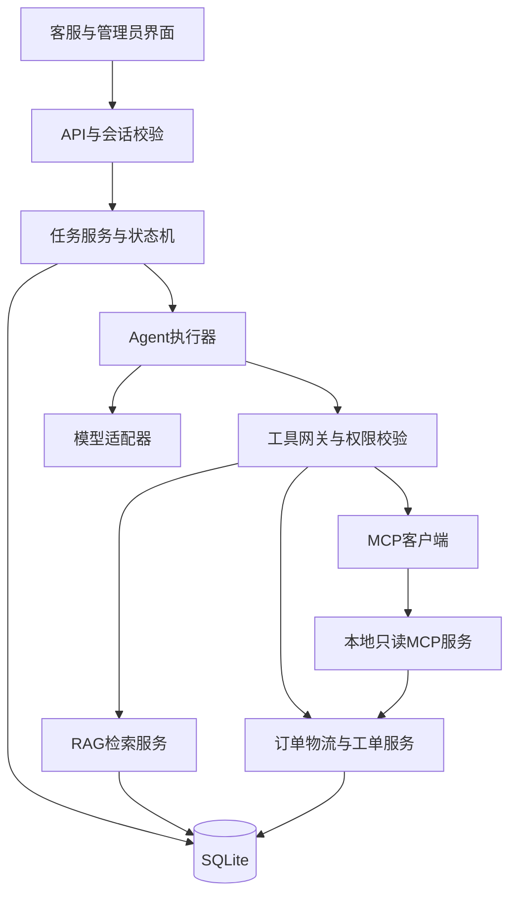

# corpMind 架构与接口设计

版本：v0.2-draft。日期：2026-10-26。状态：设计初稿，待技术验证与评审；未实现。

## 1. 设计范围与技术基线

单机部署、一个后端执行器、一个本地 MCP 服务、一个界面，业务数据均为模拟数据。首版不用分布式队列和微服务。

| 层次       | 设计选择                                                                            |
| ---------- | -----------------------------------------------------------------------------------:|
| 界面       | 后端验收后采用 Streamlit，只通过HTTP接口访问业务                                    |
| API与契约  | Python 3.12、FastAPI、Pydantic                                                      |
| 业务与状态 | 独立业务服务、有限状态机、SQLite事务和迁移版本                                      |
| Agent      | 手写最小工具循环与注册表，模型采用结构化工具调用；框架迁移作为后续比较              |
| 检索       | NumPy精确余弦检索；BM25与RRF混合；可切换重排适配器                                  |
| 模型       | 生成、向量化、重排独立适配；优先验证百炼 qwen-plus、text-embedding-v4、qwen3-rerank |
| 协议       | 本地 MCP 服务承载订单与物流只读工具，先验证stdio传输                                |
| 工程       | pytest、Ruff、依赖锁定、GitHub Actions、Docker Compose                              |

模型名称是验证候选；实际账户、地域端点、工具调用能力、单价和SDK兼容性必须验证后记录。任何向量模型、维度或规范化方式变更，必须使旧索引失效并重建。

## 2. 模块与依赖方向

API只负责输入输出与会话入口；业务规则、确认和权限由业务服务执行。模型与MCP都不能绕过服务校验。界面不直接读数据库。

## 3. 工具契约

工具的模型可见参数不包含user_id、team_id、角色或已确认标志；可信身份由工具网关注入。

| 工具                    | 模型可见输入                  | 主要输出                               | 副作用                       |
| ----------------------- | ----------------------------- | -------------------------------------- | ---------------------------- |
| get_order               | order_id                      | 已授权订单、版本和关联物流标识         | 无                           |
| get_logistics           | order_id                      | 当前轨迹、签收信息、预计时间、查询时间 | 无                           |
| search_policy           | query、order_id               | 适用政策片段、版本、位置、引用ID       | 无                           |
| search_similar_cases    | query、order_id               | 授权历史案例及相似点                   | 无                           |
| create_after_sales_case | proposal_id、proposal_version | 工单ID和创建结果                       | 仅当前方案经人工确认后可执行 |

订单号与政策适用条件由服务再次校验；模型不能扩大查询范围。工具返回统一结果：ok、data或error、evidence_refs、observed_at、request_id。错误包含稳定代码及retryable，不包含密钥、原始供应商报错或受限对象详情。

参数使用Pydantic校验。未知工具、无效参数、未授权调用不执行；记录失败并计入工具尝试上限。只读瞬时错误最多重试一次。模型与工具调用的超时不得超过本次运行剩余活动时间。写工具不由Agent盲目重试；通过数据库唯一约束和幂等记录核对结果。

## 4. Agent执行与证据

1. 读取当前任务、用户输入、授权身份和有效工作笔记。
2. 模型输出简短计划摘要及结构化工具请求或最终方案。
3. 工具网关依次检查白名单、参数、权限、额度与截止时间，再执行。
4. 持久化工具结果和证据，向模型提供精简观察结果，决定继续、追问或形成方案。
5. 输出方案前检查引用存在、原文一致、业务规则适用和关键字段依据。
6. 需要创建工单时进入awaiting_confirmation，等待API记录的人工确认。

程序检查引用与字段，不把模型自评当作证据充分性的唯一判定。ReAct是主实现；Plan-and-Solve可作为独立实验模式，不要求串联全部范式。一次可选的模型复核计入模型请求上限，不能绕过程序校验。

证据分为policy、order、logistics、historical_case和user_report。客户陈述标为user_report，只能证明客户作出过该陈述，不能当成物流事实。结论引用对应证据ID；政策引用含文档版本、段落或PDF文件页码及逐字原文，业务引用含记录版本和观察时间。

## 5. 状态机与人工确认

| 当前状态              | 允许的后续状态                                                      |
| --------------------- | ------------------------------------------------------------------- |
| created               | running、cancelled                                                  |
| running               | awaiting_input、awaiting_confirmation、completed、failed、cancelled |
| awaiting_input        | running、cancelled                                                  |
| awaiting_confirmation | running、cancelled                                                  |
| failed                | running（可恢复且额度未耗尽）、cancelled                            |
| completed、cancelled  | 终态，不再执行工具                                                  |

运行请求的计数和截止时间与任务累计计数分别保存。取消后执行器在下一个安全点停止；已提交的工单事务不伪装为回滚。

方案按版本持久化，确认绑定任务所有者、方案ID、版本与内容摘要。确认时重新查询关键订单、物流与政策状态；发生变化返回409并要求生成新方案，不能沿用旧确认。

工单具有唯一的task_id与proposal_version组合。确认、幂等检查、工单插入和结果写回在事务中完成。工单成功后即使进程在返回前退出，恢复也应返回已有工单。

进程启动后将中断的running任务标为可恢复失败；用户明确恢复后重读当前事实。不得自动重放创建工单操作。

## 6. 数据与工作记忆

| 数据对象             | 核心内容                                                                               |
| -------------------- | -------------------------------------------------------------------------------------- |
| 用户与业务组         | 登录身份、密码哈希、角色、业务组关系；登录会话采用服务端可撤销的随机令牌，只存令牌哈希 |
| 知识文档与片段       | 文档ID、版本、有效状态、可见组、原文位置、内容哈希、向量模型指纹                       |
| 模拟订单与物流       | 所属业务组、记录版本、订单状态、物流轨迹、预计时间                                     |
| 任务与消息           | 所有者、状态、输入、轮次、截止时间、当前方案及错误                                     |
| 观察与工作笔记       | 已确认事实、证据ID、待解决问题、摘要、更新时间；按任务和用户隔离                       |
| 方案与确认           | 结构化内容、版本、摘要、确认人、确认时间及失效原因                                     |
| 工单与幂等记录       | 任务、方案版本、问题类型、处理建议、证据快照与实际创建结果                             |
| 执行事件、用量与反馈 | 工具状态、耗时、模型及token用量、价格配置、反馈；不记录密钥或模型私有推理              |

外键、唯一约束、事务和迁移版本必须启用。单个工作执行器按任务顺序运行，避免把并发调度作为首版范围。

工作笔记不复制全部聊天。超过配置的上下文预算时，保留任务目标、当前事实、关键证据和未解决问题；摘要不能替代源记录。恢复与写入前重新查询可变业务事实。历史案例必须有来源与维护状态，不自动把用户意见记为政策。

## 7. API草案

所有资源均在服务端校验归属；以下接口待实现后生成OpenAPI并进行契约测试。

| 接口                                                 | 作用                                                         |
| ---------------------------------------------------- | ------------------------------------------------------------ |
| POST /auth/login；POST /auth/logout；GET /me         | 登录、注销和当前身份                                         |
| GET /documents；POST /documents；GET /documents/{id} | 列表、导入和授权原文查看                                     |
| PUT /documents/{id}；DELETE /documents/{id}          | 管理员更新和删除，维护版本与索引                             |
| POST /tasks                                          | 接收目标，返回202与task_id；创建不执行写工具                 |
| GET /tasks；GET /tasks/{id}                          | 当前用户任务及状态、证据、方案                               |
| POST /tasks/{id}/messages                            | 补充信息或回答澄清问题                                       |
| POST /tasks/{id}/confirm                             | 确认指定方案版本，进入受控执行；不得接受任意改写后的工单字段 |
| POST /tasks/{id}/resume；POST /tasks/{id}/cancel     | 显式恢复或取消                                               |
| GET /tasks/{id}/events                               | 按序号增量查询工具和阶段事件，初版界面轮询                   |
| GET /cases；GET /cases/{id}                          | 当前用户的工单及实际创建结果                                 |
| POST /tasks/{id}/feedback                            | 记录反馈                                                     |

确认请求包含proposal_id和proposal_version，最终工单字段从服务端已保存方案读取。错误响应包含code、message、request_id、retryable。认证失败401，不可用资源404，无效输入422，过期方案409，限额429，外部服务失败502或504。

## 8. MCP边界

MCP用于工具发现和调用，不替代Agent调度、业务权限或人工确认。只暴露get_order和get_logistics；写工具保留在受控本地服务。

服务端使用可信调用上下文校验业务组，不信任模型提供的身份字段。传输变化不改变业务返回值和授权结果。具体SDK和上下文传递方式在技术验证中确定并通过越权测试后启用；此前仅使用进程内工具。

参考：[MCP官方架构](https://modelcontextprotocol.io/docs/learn/architecture)、[FastAPI官方教程](https://fastapi.tiangolo.com/tutorial/)、[Agent模式参考](https://www.anthropic.com/research/building-effective-agents)。
